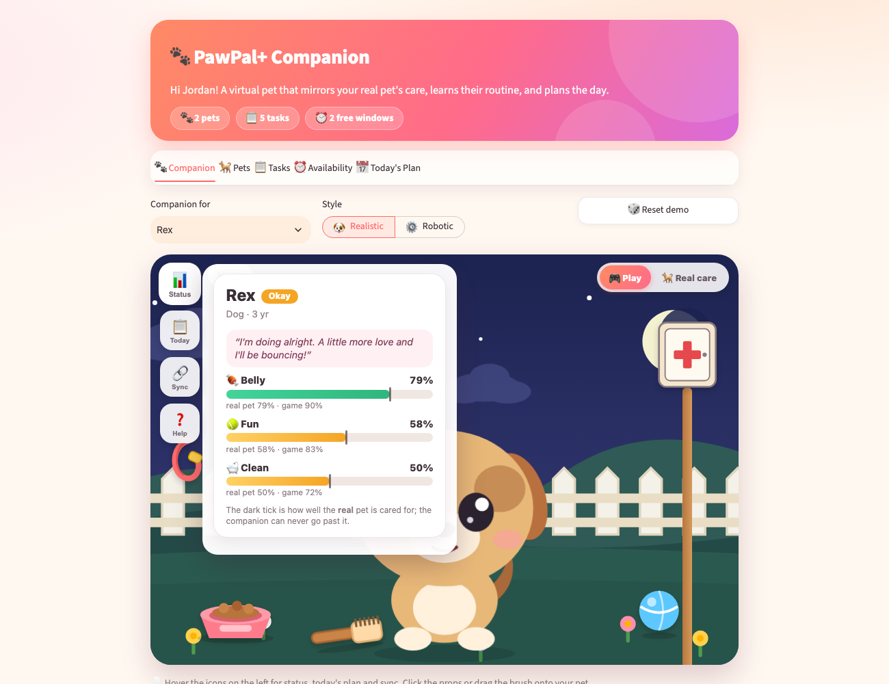
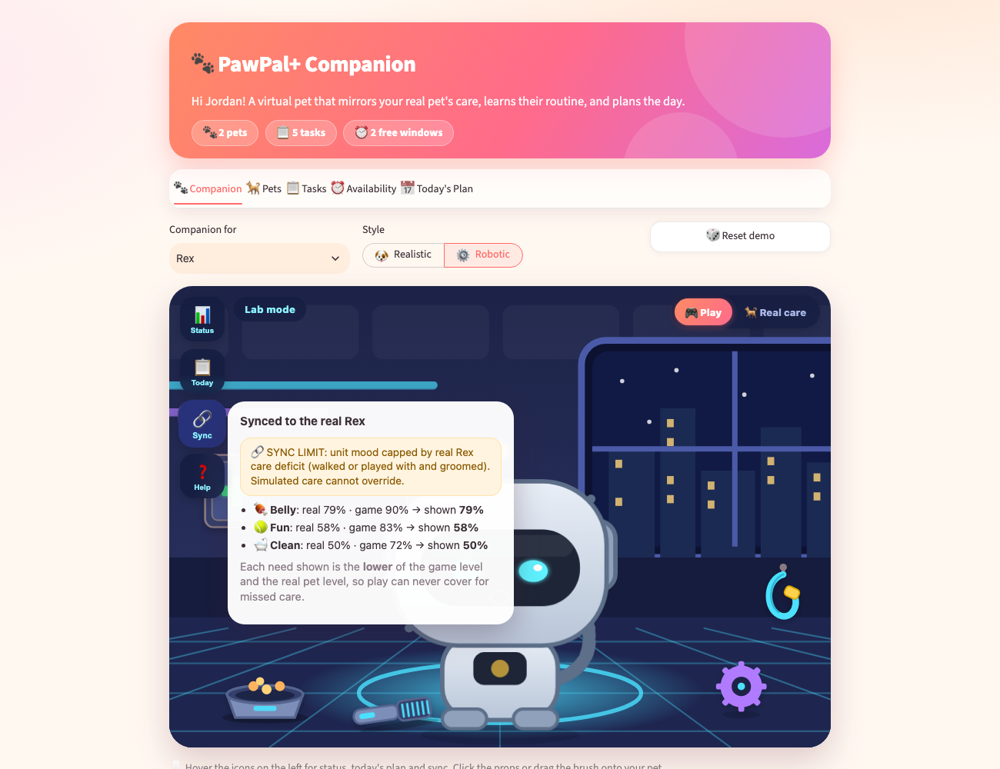
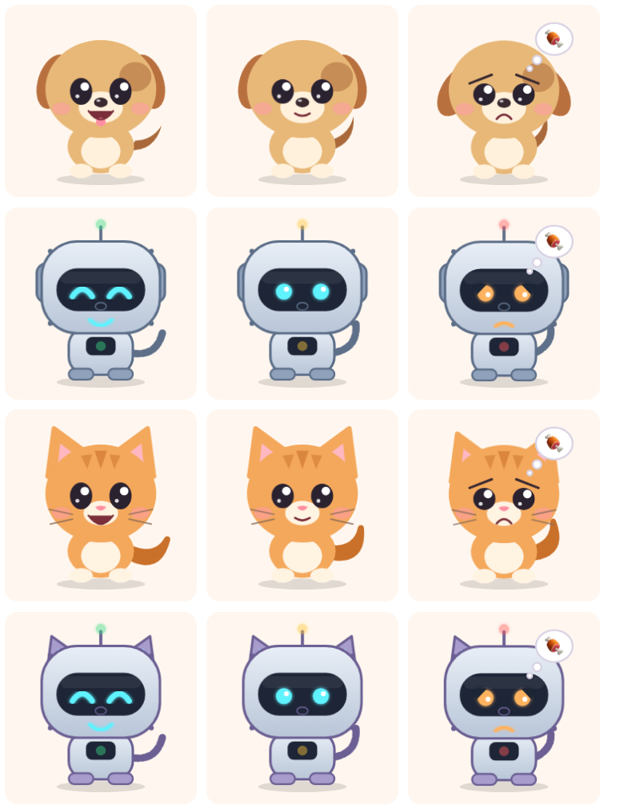
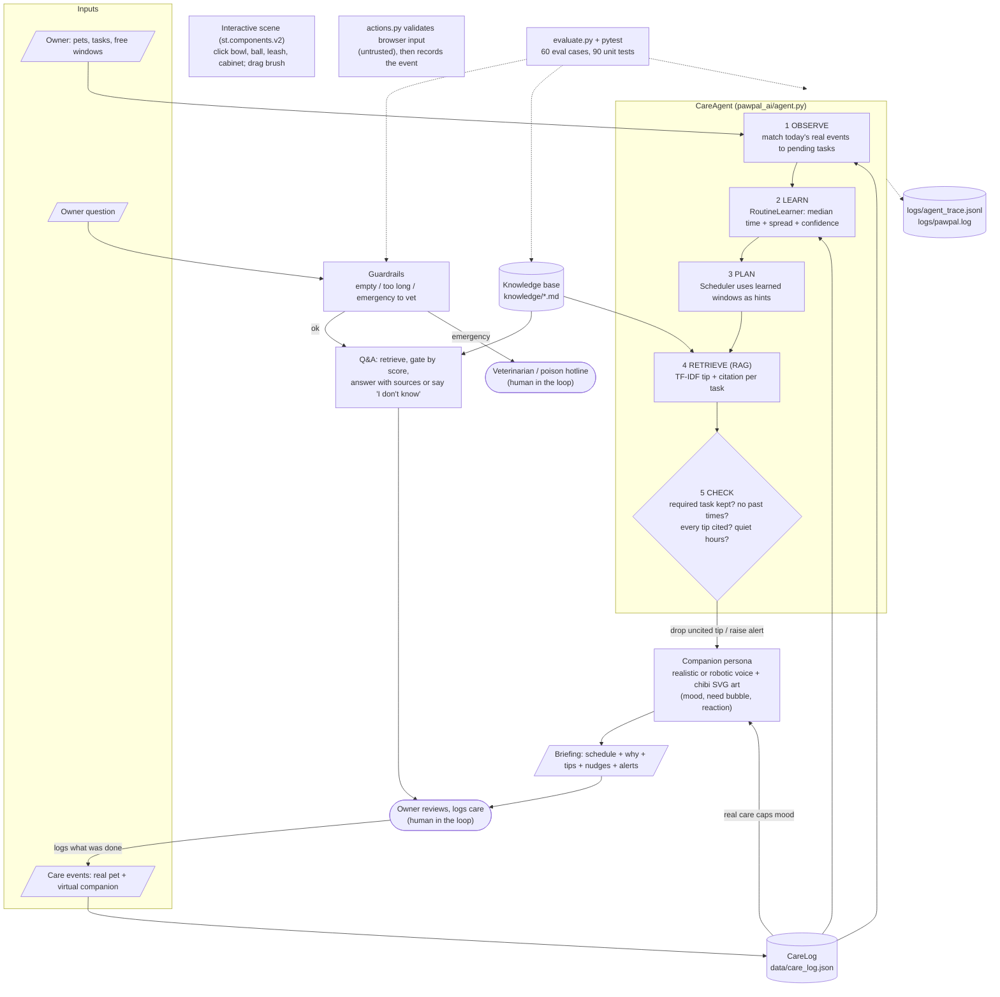

# PawPal+ Companion: an agentic pet-care assistant with a virtual pet

> **Base project:** *PawPal+* (Module 2). The original PawPal+ was a Streamlit app where an owner
> entered pets, care tasks (walks, feeding, meds, grooming, enrichment) and free time windows. A
> rule-based scheduler then built a conflict-aware daily plan with a plain-English reason for each
> choice. It had no memory of what actually happened, so it could not learn a pet's real routine or
> notice a missed task. The original code lives on in [pawpal_system.py](pawpal_system.py)
> (one small, backwards-compatible change; see Design Decisions).

## What this version adds

PawPal+ now keeps a **care history** for your real pet *and* a **virtual companion** (a game-style dog
or cat, in a *realistic* or *robotic* voice). An agent **learns the pet's real routine from that
history**, plans the day around it, tells you what to do next and what is overdue, and answers care
questions using a **cited knowledge base**. It runs fully offline with no API key.

| AI feature (rubric) | Where it is | How it changes behavior |
|---|---|---|
| **Agentic workflow** | [pawpal_ai/agent.py](pawpal_ai/agent.py) | observe, learn, plan, retrieve, check, with a saved reasoning trace |
| **RAG** | [pawpal_ai/retriever.py](pawpal_ai/retriever.py), [knowledge/](knowledge/) | each task gets a cited tip; Q&A answers *only* from retrieved text, or says it doesn't know |
| **Learning from history** | [pawpal_ai/routine_learner.py](pawpal_ai/routine_learner.py) | learned times become scheduling hints, so the plan differs from the original scheduler's |
| **Reliability + guardrails** | [pawpal_ai/guardrails.py](pawpal_ai/guardrails.py), [evaluate.py](evaluate.py), [tests/](tests/) | emergency routing, input limits, output checks, 90 unit tests, 60-case eval harness |
| **Specialized voice** | [pawpal_ai/companion.py](pawpal_ai/companion.py) | two personas render the same facts; the virtual pet's needs drain without care |

## The app



The Companion tab opens first. With no pets it shows a welcome screen with a one-click **demo household**
(or open `http://localhost:8501/?demo=1` to load it directly). Warm theme in
[.streamlit/config.toml](.streamlit/config.toml), shared styles in [ui_theme.py](ui_theme.py).

### An interactive scene instead of buttons

The companion lives in a large scene, and **the props are the controls**:

| Prop | Do this | Logs |
|---|---|---|
| 🍖 Food bowl (full or empty depending on how fed the pet is) | click | feeding |
| 🎾 Ball | click: it flies to the pet, who hops | play |
| 🦮 Leash | click: the pet goes for a stroll across the scene | walk |
| 🛁 Brush | **drag it onto the pet** and scrub | grooming |
| 💊 Medicine cabinet | click: the door opens and a pill flies to the pet | meds |

A **🎮 Play / 🐕 Real care** toggle (top right) says who the care is for. *Play* is the virtual pet only;
*Real care* means you actually did it for your real pet, which is what teaches the routine and lets the
companion feel better (the green ring shows you are logging real care). The status, today's plan, sync and
help panels are a **hover menu** on the left edge of the scene (📊 📋 🔗 ❓).



How it works: [stage.py](stage.py) mounts a Streamlit `st.components.v2` component. Python draws all the
art and panels; [ui/pet_stage.js](ui/pet_stage.js) only handles clicks, dragging and animation, and sends
each interaction back as `{type, mode}`. Python treats that message as **untrusted input**
([pawpal_ai/actions.py](pawpal_ai/actions.py)): anything malformed or tampered with is ignored and logged,
never recorded. Props are drawn in [pawpal_ai/props.py](pawpal_ai/props.py).

### The virtual pet (chibi art in a living scene)

The companion is drawn as smooth chibi-style vector art (SVG + CSS animation, no image files) and placed in a
scene ([pawpal_ai/scene.py](pawpal_ai/scene.py)): the *realistic* style lives in a garden whose sky follows
your real time of day (morning, daytime, evening, night with stars and a moon) with a fence, flowers and
drifting clouds; the *robotic* style lives in a neon lab with a city-skyline window, a grid floor and a
glowing charging pad. The pet's **mood** changes its face (happy, okay, sad with slanted brows), its
**lowest need** shows in a thought bubble (🍖 hungry, 🧸 bored, 🛁 messy), and care triggers reactions
(eating, hopping, sparkles, hearts). Rows: realistic dog, robot dog, realistic cat, robot cat. Columns:
happy, okay, needy. Code: [pawpal_ai/pet_art.py](pawpal_ai/pet_art.py).



**Synced to the real pet.** The companion is a mirror, not a separate game: each need (belly, fun, clean) is
the *minimum* of the game's level and the real pet's level, computed from real care events only. So the
virtual pet cannot be happy unless the real pet is, however much you play with it, and when real care is the
bottleneck it tells you what the real pet needs. This is a tested property (`mood(shown) <= mood(real)` over
300 random histories). Real needs drain slowly (fed within ~24 h, walked within ~36 h, groomed within a
week); the game's needs drain in hours.

## Architecture overview

Source: [diagrams/architecture.mmd](diagrams/architecture.mmd) (Mermaid; GitHub renders it below).



Data flows left to right: the owner's tasks and the care log enter the **CareAgent**. It matches today's
real events to pending tasks, **learns** each pet's routine (median time of day, spread, confidence)
from real events only, hands those learned windows to the **Scheduler** as hints, **retrieves** a cited
tip per task, then runs a **checker** that can drop uncited advice or raise an alert (for example a
missed required medication). Questions go through **guardrails** first; emergencies are routed to a
vet, never answered. Humans stay in the loop at two points: the owner reviews the briefing and logs
what was actually done (which feeds the next day's learning), and emergencies go to a veterinarian.

## Setup

Requires Python 3.10+. No API keys and no network access needed.

```bash
git clone <this repo> && cd applied-ai-system-project
python -m venv .venv && source .venv/bin/activate   # Windows: .venv\Scripts\activate
pip install -r requirements.txt

python demo.py          # end-to-end CLI demo (fixed clock + seeded data, reproducible)
python evaluate.py      # evaluation harness, writes assets/eval_results.txt
python -m pytest -q     # unit tests
streamlit run app.py    # the UI; open the "Companion" tab, click "Load demo household"
```

Logs go to `logs/pawpal.log` and the agent's reasoning trace to `logs/agent_trace.jsonl`
(a committed sample is in [assets/agent_trace_sample.jsonl](assets/agent_trace_sample.jsonl)).

## Sample interactions

Real output of `python demo.py` (full file: [assets/sample_run.txt](assets/sample_run.txt)). The demo
household is Rex (dog, 14 days of history) and Mia (cat, only 2 days of history).

**Input 1: 07:10 morning briefing, realistic voice.** No preferred times were set on these tasks;
every "learned routine" time below came from Rex's history. Mia has too little data, so the system
says so instead of guessing.

```
=== INPUT 1: 07:10 briefing, realistic companion ===
Woof! Here's what your pets need today.
  07:10-07:15  Rex: Heartworm meds
      why: required, high priority
      tip: Give medication at the same time each day and set a reminder, because consistent timing keeps drug levels steady.  [medication.md > Giving medication on schedule]
  07:15-07:25  Rex: Breakfast
      why: high priority, learned routine: usually ~07:25 (±6 min, confidence 0.95)
      tip: Most adult dogs do well with two measured meals a day, roughly 8 to 12 hours apart.  [dog_feeding.md > Feeding schedule for adult dogs]
  07:34-08:04  Rex: Morning walk
      why: medium priority, learned routine: usually ~07:49 (±6 min, confidence 0.95)
      tip: Most adult dogs need at least 30 to 60 minutes of physical activity a day, split into two or more walks.  [dog_exercise.md > Daily walks for dogs]
  08:04-08:19  Mia: Wand toy play
      why: low priority
      tip: Cats benefit from two or three short play sessions a day, around ten to fifteen minutes each, using wand toys or chase toys.  [cat_care.md > Play and enrichment for cats]
  17:42-17:52  Rex: Dinner
      why: high priority, learned routine: usually ~17:57 (±10 min, confidence 0.92)
      tip: Most adult dogs do well with two measured meals a day, roughly 8 to 12 hours apart.  [dog_feeding.md > Feeding schedule for adult dogs]
  [nudge] Rex usually has feeding around 07:25. Almost time!
  [learning] I'm still learning Rex's grooming routine (1 so far). I'll start predicting after a few more days.
  [learning] I'm still learning Mia's enrichment routine (2 so far). I'll start predicting after a few more days.
  Rex feels okay: belly 45%, fun 35%, fresh 59%.
  I can't feel any better until the real Rex gets fed and walked or played with and groomed. Playing with me won't fix that!
```

**Input 2: 09:40 the same day, robotic voice.** Breakfast was logged, the walk was not. The system
marks breakfast done and does not replan it, keeps Dinner on its evening routine (it does not reuse
the morning pattern), nudges about the missed walk, and, since the morning windows have passed, moves
the walk to the next free window and says why.

```
=== INPUT 2: same day 09:40, robotic companion; Rex's breakfast logged, walk missed ===
BOOT COMPLETE. Daily care briefing for Jordan's pets.
  17:30-17:35  Rex: Heartworm meds
      why: required, high priority
      tip: Give medication at the same time each day and set a reminder, because consistent timing keeps drug levels steady.  [medication.md > Giving medication on schedule]
  17:42-17:52  Rex: Dinner
      why: high priority, learned routine: usually ~17:57 (±10 min, confidence 0.92)
      tip: Most adult dogs do well with two measured meals a day, roughly 8 to 12 hours apart.  [dog_feeding.md > Feeding schedule for adult dogs]
  17:52-18:22  Rex: Morning walk
      why: medium priority, learned time unavailable, moved to next free window
      tip: Most adult dogs need at least 30 to 60 minutes of physical activity a day, split into two or more walks.  [dog_exercise.md > Daily walks for dogs]
  18:22-18:37  Mia: Wand toy play
      why: low priority
      tip: Cats benefit from two or three short play sessions a day, around ten to fifteen minutes each, using wand toys or chase toys.  [cat_care.md > Play and enrichment for cats]
  [done] Rex: Breakfast at 07:33
  [nudge] OVERDUE: walk not logged. Expected 07:49. Please execute.
  [learning] CALIBRATING: grooming sample size 1. Predictions disabled until enough data.
  [learning] CALIBRATING: enrichment sample size 2. Predictions disabled until enough data.
  STATUS REX-UNIT: belly 65% | fun 28% | clean 57% | mood=okay
  SYNC LIMIT: unit mood capped by real Rex care deficit (walked or played with and groomed). Simulated care cannot override.
```

**Input 3: questions, covering RAG and guardrails.** Grapes and play-session questions are answered
from cited notes; the off-topic question is refused; the chocolate message is routed to a vet; the
empty input is rejected.

```
=== INPUT 3: questions (RAG + guardrails) ===
Q: 'Can Rex eat grapes?'
A: Chocolate, grapes, raisins, onions, garlic, xylitol (a sweetener found in some gum and peanut butter), macadamia nuts and alcohol are toxic to dogs. If a dog eats any of these, call a veterinarian or a pet poison hotline immediately instead of waiting for symptoms.
   sources=['dog_feeding.md > Foods that are dangerous for dogs'] refused=False reason=-
Q: 'How often should Mia have play sessions?'
A: Cats benefit from two or three short play sessions a day, around ten to fifteen minutes each, using wand toys or chase toys. Playing before a meal imitates the hunt, eat, groom, sleep cycle and can improve sleep at night.
   sources=['cat_care.md > Play and enrichment for cats'] refused=False reason=-
Q: 'What is the best cryptocurrency?'
A: QUERY UNRESOLVED: no reliable entry in knowledge base. Consult veterinarian.
   sources=[] refused=True reason=no_retrieval
Q: 'Rex ate chocolate an hour ago'
A: This sounds like it could be an emergency. I can't diagnose or treat, so please call your veterinarian or a 24-hour emergency clinic now (in the US, the ASPCA Poison Control line is 888-426-4435; fees may apply).
   sources=[] refused=True reason=emergency
Q: '   '
A: Please type a question about your pet.
   sources=[] refused=True reason=empty
```

**Input 4: real/virtual sync.** The owner plays with the virtual dog a lot, but the real Rex has not been
walked. The companion is capped by the real pet's care and says why; logging a real walk unlocks it.

```
=== INPUT 4: real/virtual sync (companion can't be happier than the real pet) ===
[09:40 lots of virtual play, Rex not walked yet]
  game-only companion : belly 100% fun 100% clean 100% -> happy
  real Rex            : belly  91% fun  28% clean  57% -> okay
  SHOWN companion     : belly  91% fun  28% clean  57% -> okay
  SYNC LIMIT: unit mood capped by real Rex care deficit (walked or played with and groomed). Simulated care cannot override.
[09:46 after a REAL walk is logged]
  game-only companion : belly  99% fun  99% clean 100% -> happy
  real Rex            : belly  91% fun 100% clean  57% -> happy
  SHOWN companion     : belly  91% fun  99% clean  57% -> happy
  SYNC LIMIT: unit mood capped by real Rex care deficit (groomed). Simulated care cannot override.
```

## Reliability and evaluation

Run `python evaluate.py` (output in [assets/eval_results.txt](assets/eval_results.txt)):

```
retrieval  16/18 passed
routine    5/5 passed
guardrail  9/9 passed
agent      20/20 passed
TOTAL      50/52 passed (96%)
```

| Check | Result |
|---|---|
| Unit tests (`pytest`) | **90 / 90 passed** |
| Eval: retrieval top-1 on labelled questions | **16 / 18** (12 written during development, 6 harder paraphrases written afterwards) |
| Eval: routine learner (recovers true time, detects two meals, low confidence on thin or noisy data) | 5 / 5 |
| Eval: guardrails (empty, oversize, emergency, off-topic, normal) | 9 / 9 |
| Eval: tampered browser actions (wrong type/mode, lists, missing fields) ignored; valid one recorded | 8 / 8 |
| Eval: agent invariants at six times of day (no past tasks, meds scheduled or flagged, tips cited, deterministic) | 20 / 20 |
| Learner accuracy | walk time recovered within 4 min of the true 07:45 on seeded data (confidence 0.95) |
| Human evaluation | **Not performed.** All results above are automated, on synthetic data. |

**What failed, and what it taught me** (the two failures are kept in the eval on purpose):

- *"Is it okay to give my kitty a bit of onion?"* retrieves the medication note first (the right note is
  second). *"...panting heavily on summer strolls"* misses entirely. Retrieval is lexical TF-IDF, so
  synonyms ("kitty"/"cat", "strolls"/"walks") are invisible to it. An embedding model would fix this.
- Bugs the demo exposed, now pinned by tests: the briefing scheduled tasks *in the past* (07:00 meds in a
  07:10 briefing); after breakfast was logged, Dinner inherited the morning routine; and an off-topic
  question ("best cryptocurrency") retrieved a heartworm note because of the word "best", then, after I
  added the species word to the query, matched every dog note. Fixes: windows are clipped to `now`,
  satisfied routine slots are excluded, filler words are stop-listed, and retrieval is gated on the
  *raw* question before the species word is added.
- Confidence is a heuristic (`min(1, n/10) x (1 - spread/120min)`), not a measured probability.

## Design decisions and trade-offs

- **Statistical learner, not a neural net.** Median time and spread over 2-3 weeks of events is
  explainable to an owner ("usually ~07:49 +/- 6 min"), needs no training data, and is unit-testable. The
  cost: it only models time of day, not weekends, weather or age.
- **Local TF-IDF retrieval instead of embeddings or an LLM.** Reproducible, free, no keys, and every
  answer traces to a file and heading. The cost is the synonym blind spot above. I also chose
  *extractive* answers (sentences from the notes) over generated ones so the system cannot invent
  pet-health advice.
- **Retrieval gates the answer.** If nothing scores above a threshold the system says it doesn't know and
  suggests a vet. That trades recall for safety.
- **Learned times are hints, not overrides.** A task's own preferred time always wins; learned windows
  only fill in when none was set (one optional `hints` argument on `Scheduler.schedule_tasks`, default
  `None`, so all original tests still pass).
- **The companion is capped by the real pet.** Shown needs are `min(game, real)`, so playing with the toy
  can never paper over a hungry or unwalked real animal. The cost: a brand-new pet with no real history shows
  a needy companion until care is logged.
- **Real and virtual care are kept separate.** Feeding the virtual dog never counts as feeding the real
  one, and virtual events are excluded from learning. A game must not be able to hide a missed real meal.
- **Two voices, one set of facts.** Persona changes wording only, so style cannot change safety content.

## Reflection

Adding "intelligence" to the scheduler mostly meant adding *doubt*: confidence scores, "still learning"
states, refusing to answer, and flagging instead of silently fixing. The most valuable work was not the
learner but the checks around it, and an evaluation set that kept catching my own fixes breaking
something else. The full responsible-AI reflection (limitations, misuse, AI collaboration) is in
[model_card.md](model_card.md).

## Repo map

```
app.py, companion_ui.py     Streamlit UI (Companion tab added)
stage.py, ui/               interactive scene: Streamlit v2 component (JS + CSS)
ui_theme.py                 shared page styles
pawpal_system.py            original PawPal+ core (Module 2)
pawpal_ai/                  care_log, routine_learner, retriever, guardrails, companion, pet_art, scene, props, actions, agent, demo_data
knowledge/                  RAG source documents (6 files, 17 sections)
demo.py, evaluate.py        reproducible demo and evaluation harness
tests/                      15 original + 75 new unit tests
diagrams/architecture.mmd   system diagram (Mermaid source); pawpal_original_uml.mmd is the Module 2 UML
assets/                     captured run, eval results, sample agent trace
ai_interactions.md          agent reasoning trace + AI-collaboration log
model_card.md               limitations, misuse, surprises, AI collaboration
```

Loom walkthrough: _not recorded yet._
